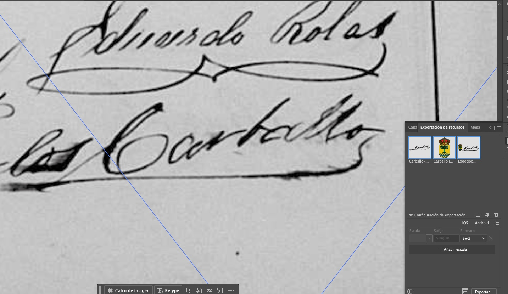
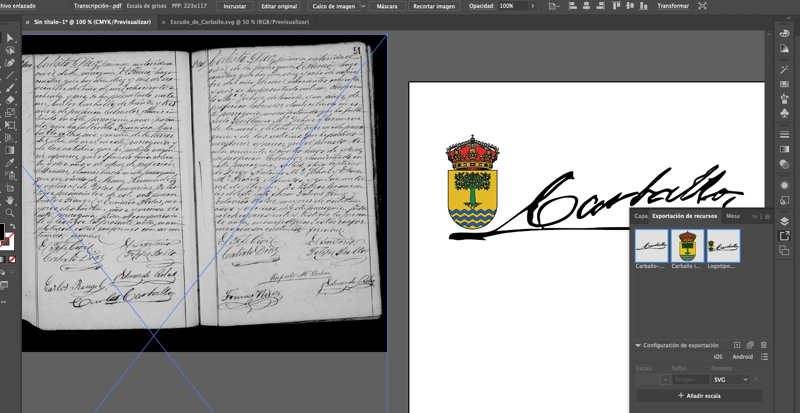

# Carballo

<picture>
  <source media="(prefers-color-scheme: dark)" srcset="source/src/marca/carballo-claro.webp">
  
</picture>

Carballo is a family history website that brings a genealogy, transcriptions, and historical records together in a browser-based document viewer.

**Designed and developed by [Martin Alejandro Morfe Carballo](https://github.com/morfemartin) · [Morfe Estudio](https://morfe.studio/)**

[View the family edition on GitHub Pages](https://morfemartin.github.io/expediente-familiar/) · [Run the English demo](#run-the-english-demo)

## From handwritten signature to visual identity

The identity began with Carlos Carballo's signature on Francisco Carballo's 1886 death record. In Adobe Illustrator, I examined the handwritten strokes at a larger scale and developed three vector assets: the signature, the coat of arms, and the combined mark.





The coat of arms retains its original colors. The signature has separate versions for light and dark backgrounds, and the coat of arms doubles as the favicon. The site serves the marks as WebP images.

## How the site works

- **Static generation.** A dependency-free Node.js generator builds the record pages, transcriptions, and encrypted folios for GitHub Pages.
- **Access and reading.** The browser decrypts the archive with AES-256-GCM through Web Crypto. The encryption key is derived with PBKDF2-SHA-256. Individual folios load and decrypt as readers scroll and can be zoomed or downloaded in the viewer.
- **Visit logging.** The private edition can record the name entered at sign-in using an Apps Script web app and a Google Sheet. The endpoint is stored in the encrypted archive.

The published site's initial HTML transfer dropped from **680 kB to 10 kB**. Median time until the access form was ready dropped from **4.50 s to 0.26 s**, measured across three cold loads per version in Chrome on a simulated mobile connection. The encrypted archive starts downloading when the visitor moves focus to the form.

## Run the English demo


The demo includes a fictional folio, its transcription, and a document note. It requires Node.js 22 or later and Python 3 for the local server.

```sh
git clone https://github.com/morfemartin/expediente-familiar.git
cd expediente-familiar
PASSWORD=carballo-demo node source/build.mjs
python3 -m http.server 8765 --bind 127.0.0.1 --directory source/dist
```

Open [the local demo](http://127.0.0.1:8765/), enter a sample name, and use the password `carballo-demo`.

| Path | Contents |
| --- | --- |
| [`source/build.mjs`](source/build.mjs) | Static generator and browser application |
| [`source/src/datos.mjs`](source/src/datos.mjs) | Demo configuration and sample records |
| [`source/registro_apps_script.gs`](source/registro_apps_script.gs) | Optional Google Sheets visit logger |
| [`docs/illustrator/`](docs/illustrator/) | Original screenshots of the design process |

The demo builds to `source/dist/`. The family edition is served from the repository root with its documentary content encrypted. Passwords and private configuration are stored locally.
