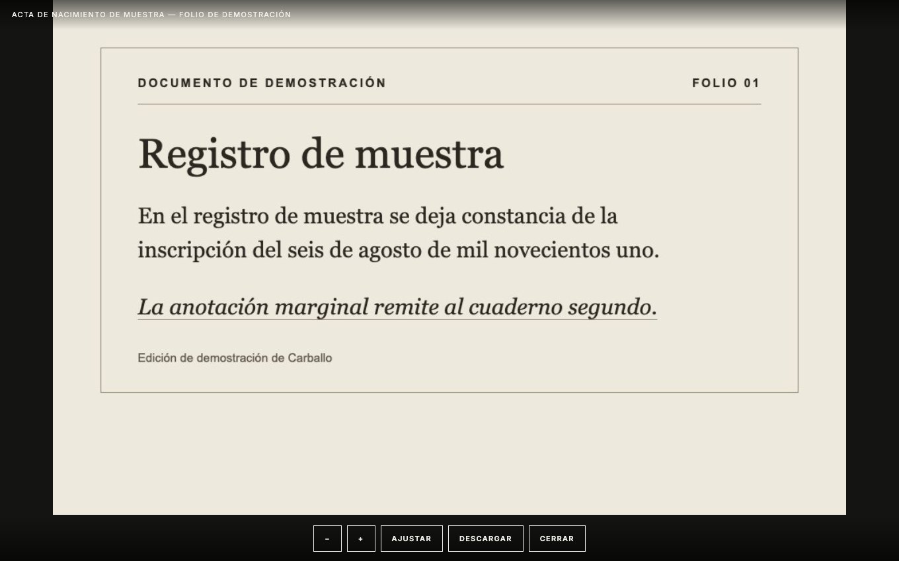

# Carballo

<picture>
  <source media="(prefers-color-scheme: dark)" srcset="source/src/marca/carballo-claro.webp">
  
</picture>

Archivo web familiar con identidad visual propia. Reúne una línea genealógica, transcripciones y un visor de actas históricas para leer y cotejar los documentos desde el navegador.

**Diseño y desarrollo por [Martin Alejandro Morfe Carballo](https://github.com/morfemartin) · [Morfe Estudio](https://morfe.studio/)**

[Ver la edición publicada en GitHub Pages](https://morfemartin.github.io/expediente-familiar/) · [Probar la demo local](#probar-la-demo)

## De la firma al logotipo

La identidad parte de la firma de Carlos Carballo que aparece en el acta de defunción de Francisco Carballo, de 1886. En Adobe Illustrator amplié el trazo manuscrito y trabajé tres variantes vectoriales, la firma, el escudo y la composición que reúne ambos elementos.


La composición mantiene el color del escudo y adapta la firma a fondos claros y oscuros. El escudo también funciona como favicon. La web usa exportaciones WebP de la familia de marcas.

## Cómo funciona la web

- **Generación estática.** Node.js compila las fichas, sus transcripciones y los folios para publicar en GitHub Pages. El generador funciona sin dependencias de npm.
- **Acceso y lectura.** El expediente se descifra en el navegador mediante Web Crypto, con AES-GCM de 256 bits y una clave derivada con PBKDF2-SHA-256. Los folios se descifran individualmente conforme se recorren y se pueden ampliar y descargar desde el visor.
- **Registro de visitas.** La edición privada puede registrar el nombre declarado al abrir el expediente mediante una aplicación web de Apps Script y una hoja de Google Sheets. La URL de registro viaja dentro del expediente cifrado.

El documento inicial de la web publicada pasó de **680 kB a 10 kB transferidos**, y el tiempo hasta que el formulario estuvo listo pasó de **4,50 s a 0,26 s**. Son medianas de tres cargas en frío en Chrome con red móvil simulada. El cuerpo del expediente empieza a descargarse al enfocar el formulario.

## Probar la demo



La demo incluye un folio ficticio, una transcripción y una nota documental. Requiere Node.js 22 o posterior y Python 3 para servir los archivos en local.

```sh
git clone https://github.com/morfemartin/expediente-familiar.git
cd expediente-familiar
CLAVE=carballo-demo node source/build.mjs
python3 -m http.server 8765 --bind 127.0.0.1 --directory source/dist
```

Abre [la demo en localhost](http://127.0.0.1:8765/), escribe un nombre de prueba y utiliza la clave `carballo-demo`.

| Ruta | Contenido |
| --- | --- |
| [`source/build.mjs`](source/build.mjs) | Generador estático y aplicación del navegador |
| [`source/src/datos.mjs`](source/src/datos.mjs) | Configuración y fichas de demostración |
| [`source/registro_apps_script.gs`](source/registro_apps_script.gs) | Receptor opcional del registro en Google Sheets |
| [`docs/illustrator/`](docs/illustrator/) | Capturas del proceso de diseño |

La demo se compila en `source/dist/`. La edición familiar se publica desde la raíz del repositorio con el contenido documental cifrado. Las claves y la configuración privada se mantienen en archivos locales.
